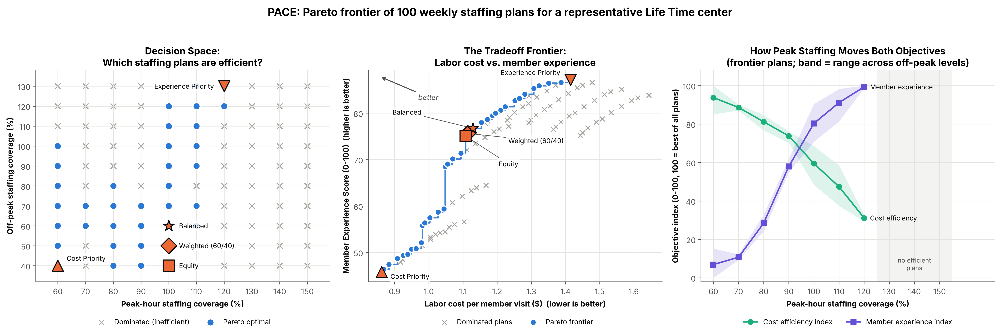

# PACE: Predictive Allocation for Club Excellence

**Multi-objective staffing optimization for Life Time (NYSE: LTH)**
*Justin Null | Final Project*



## Overview
PACE is a decision-support tool for staffing a Life Time athletic country club. It answers one question: **how should a center split its weekly flexible labor (floor staff, trainers on shift, group fitness instructors, childcare) between peak and off-peak hours?** It maps every efficient tradeoff between **labor cost per member visit** and a **Member Experience Score**. In Phase 2 it will recommend a specific plan that respects real business constraints. It is built for center general managers and regional operations leaders.

## Business Context
Life Time sells an experience, not a gym pass. Center operations, its largest cost line, ran **51.6% of revenue in Q1 2026 and 53.1% in Q3 2026**, and management tied part of the increase to higher utilization in mature clubs. Membership grew only 1.4% while average revenue per center membership rose 10.2% to **$930**, so growth now depends on spend per member, and members who pay more expect more service.

That creates the tradeoff. Staffing every hour for the 6 AM and 5 PM rushes protects the experience but leaves people idle at midday. Staffing to the "average" hour saves money but produces sold-out classes, unattended floors and childcare waitlists at exactly the moments members care about. Each 1% of Q1's $406.7M center-operations expense is about $4M per quarter, so even modest efficiency that preserves the experience is material.

## Part 1: Optimization Engine (Complete ✓)

### What It Does
This optimization engine analyzes **100 combinations of peak and off-peak staffing coverage** to identify the Pareto frontier of efficient plans that balance **labor cost per visit (minimize)** against the **Member Experience Score (maximize)**.

| | Name | Range / definition |
|---|---|---|
| Decision variable 1 | `peak_coverage_pct` | 60–150% of the demand-based staffing target in peak windows (weekday 5–9 AM and 4–8 PM, weekend 8 AM–12 PM) |
| Decision variable 2 | `offpeak_coverage_pct` | 40–130% of target in all other open hours |
| Objective 1 (min) | `labor_cost_per_visit` | Floor + instructor + childcare labor (with 1.25× burden and 1.5× overtime) ÷ completed visits |
| Objective 2 (max) | `member_experience_score` | 0–100: 40% floor time-to-assistance (Erlang C queue), 35% class fill-fit ("full but not overbooked"), 25% childcare availability |

### Key Findings
- **36% of plans (36 of 100) are Pareto optimal.** The other 64 dominated plans should be avoided. A dominated plan can typically be replaced by one with equal-or-better experience for a median **$1,198 less per center-week (about $62k per year)**, and up to $4,808 per week.
- **Every plan above 120% peak coverage is dominated.** Over-staffing the rush leaves classes half empty, so experience falls while cost rises.
- **Key strategic points on the frontier:**

| Strategy | Peak / off-peak coverage | Cost per visit | Experience | Weekly labor |
|---|---|---|---|---|
| Cost Priority | 60% / 40% | $0.862 | 45.8 | $11,379 |
| Weighted (60% cost / 40% experience) | 100% / 50% | $1.114 | 75.6 | $14,757 |
| Balanced (max combined index) | 100% / 60% | $1.129 | 76.7 | $14,954 |
| Equity (smallest gap between indices) | 100% / 40% | $1.108 | 75.1 | $14,670 |
| Experience Priority | 120% / 130% | $1.415 | 87.2 | $18,742 |

- **"Staff the rush, trim the lull."** Three different philosophies (Weighted, Balanced, Equity) all choose **100% peak coverage** and differ only on off-peak hours. Peak staffing is the high-leverage decision, and off-peak staffing is a budget dial.

### Technical Approach
**Data (synthetic, LLM + Python).** Clubs don't publish hourly traffic or shift data, so I prompted an LLM (Claude) to write a **seeded simulator** to an explicit spec rather than paste numbers by hand. The exact prompt is in [`data/data_generation_prompt.txt`](data/data_generation_prompt.txt).
- Demand is calibrated to Life Time's Q1 2026 results (837,903 memberships ÷ 190 centers ≈ 4,410 per center, × 3.0 visits per week). It includes weekday double rushes, a weekend late-morning peak, and week-, day- and hour-level noise.
- Every plan is evaluated on the **same 8 simulated weeks** (common random numbers), so the comparison between plans is fair.
- Hard rules are enforced in the physics: a 1:6 childcare ratio with a two-adult minimum, at least 2 floor staff always on duty, 3 studios × 35 spots, and overtime past roster hours.
- Validation notes are in [`data/DATA_SOURCE.md`](data/DATA_SOURCE.md).

**Pareto frontier.** A plan is dominated if another plan is at least as good on both objectives and strictly better on one. The dominance test takes each objective's direction (`min` / `max`) explicitly. It is implemented twice, as a readable pairwise loop and as a vectorized NumPy check, and the notebook asserts that the two agree and that no frontier plan dominates another.

**Strategic analysis.** Because the objectives have different units ($ vs. points), the combined strategies (Balanced, Equity, Weighted) use 0–100 min-max indices.

### Agent Logic (Phase 2, coming in Unit 13)
The decision agent will filter `data/pareto_frontier.csv` with business constraints from the proposal: weekly labor-hour budget, childcare service guardrails, overtime and labor rules, and room capacity. It will then pick and explain a plan with heuristic logic. The dataset already includes the columns those constraints need (`total_labor_hours`, `overtime_hours`, `childcare_turnaways_per_week`, `class_waitlist_per_week`, `peak_time_to_assist_min`).

## Repository Structure
```
LifeTimeProject/
├── optimization_engine.ipynb      # Main analysis (Sections 1-6)
├── src/
│   └── generate_data.py           # Seeded simulator that produces the dataset
├── data/
│   ├── staffing_scenarios.csv     # 100 staffing plans (analysis dataset)
│   ├── hourly_demand.csv          # 952 simulated center-hours behind it
│   ├── pareto_frontier.csv        # 36 efficient plans (input to Phase 2)
│   ├── data_generation_prompt.txt # Exact LLM prompt
│   └── DATA_SOURCE.md             # Calibration sources + validation notes
├── images/
│   ├── data_exploration.png
│   └── pareto_frontier_analysis.png
├── requirements.txt
└── README.md
```

## Technologies
- **Python 3.10+**, **pandas**, **NumPy**, **Matplotlib**, **Jupyter Notebook**
- **Claude (Anthropic)**: LLM used to write the synthetic data generator from my specification
- Queueing theory (Erlang C / M/M/c) for floor time-to-assistance

## Setup and Installation
```bash
git clone https://github.com/justinn80/LifeTimeProject.git
cd LifeTimeProject
python -m venv .venv && source .venv/bin/activate   # optional
pip install -r requirements.txt
```

## Running the Analysis
1. Open the notebook: `jupyter notebook optimization_engine.ipynb`
2. Run all cells in order (Kernel → Restart & Run All).
3. Outputs are saved to `images/` and `data/pareto_frontier.csv`.

To regenerate or verify the dataset:
```bash
python src/generate_data.py           # rewrite data/staffing_scenarios.csv and data/hourly_demand.csv
python src/generate_data.py --check   # confirm the committed CSV is reproducible from the seed
```

## Limitations and Future Improvements
- **Synthetic, single representative center.** Wages, ratios, help-request rates and experience weights are documented assumptions, not Life Time's internal data.
- **One coverage knob per time window**, shared by all roles, with no shift-length or break rules yet. Future work: role-specific decision variables and a shift-level scheduler.
- **Static member behavior.** No demand shifting, and no link from experience to retention or revenue yet. Future work: a revenue-at-risk objective, multiple center archetypes, and a robust frontier that accounts for week-to-week noise.

## Next Steps
Part 2 will add a constraint-aware decision agent that selects among these Pareto optimal plans based on business constraints and priorities, and explains its recommendation in plain language.

## Sources
1. Life Time Group Holdings, Inc. (2026, May 5). *Life Time Reports First Quarter 2026 Financial Results.* https://ir.lifetime.life/news-events/press-releases/detail/1205
2. Life Time Group Holdings, Inc. (2026). *Form 10-Q, quarter ended March 31, 2026.* https://www.sec.gov/Archives/edgar/data/0001869198/000186919826000030/lth-20260331.htm
3. Life Time Group Holdings, Inc. (2026). *Form 10-Q, quarter ended September 30, 2026.* https://www.sec.gov/Archives/edgar/data/0001869198/000186919826000055/lth-20260930.htm
4. Six Flags / Carowinds. (2026, May). *Workforce Analyst* [Job posting]. https://careers-sixflags.icims.com/jobs/33224/workforce-analyst/job
